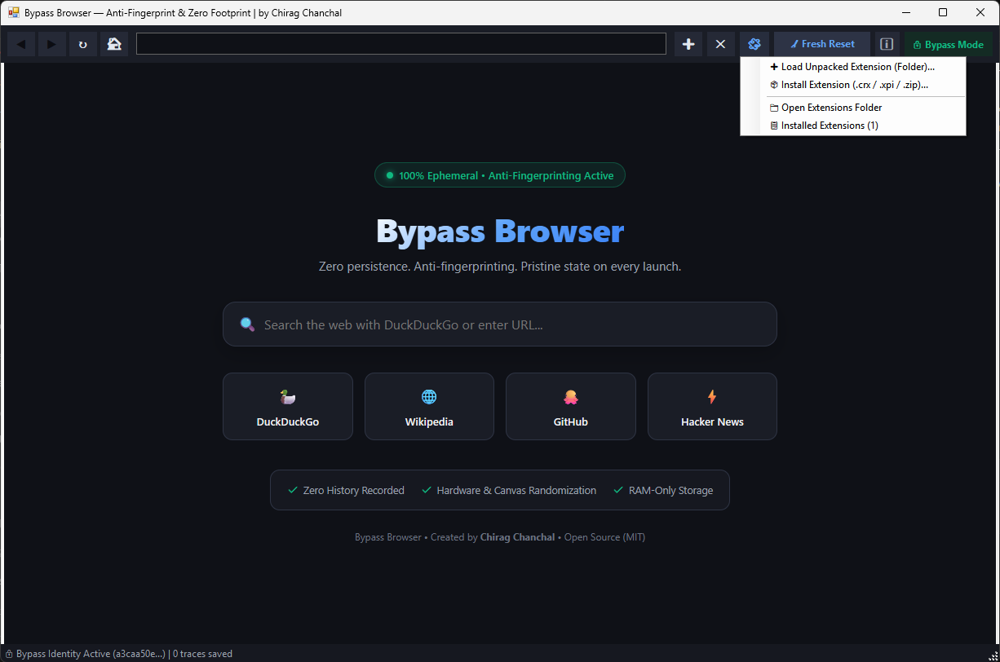

# Bypass Browser

**Bypass Browser** is a minimalist, privacy-first web browser for Windows designed for complete session freshness and anti-fingerprinting protection.

Every time you start the application, it launches into a brand-new, isolated environment with randomized hardware signatures and zero persistent traces on disk.

---

## Author & Credits

- **Creator & Maintainer:** Chirag Chanchal
- **Email:** chiragchanchal2345@gmail.com
- **License:** MIT License

---

## Core Capabilities

- **Zero Disk Persistence:** Browsing history, cookies, and cache reside strictly in memory and are discarded upon exit.
- **Anti-Fingerprint Engine:** Randomizes canvas hashes, WebGL vendor/renderer strings, and hardware concurrency values per session.
- **Extension Mode (Chrome & Firefox):** Install or load extensions directly from unpacked directories, `.crx`, `.xpi`, or `.zip` archives.
- **Security-Audited Architecture:** Strict URL scheme sanitization, disabled host bridging, and credential isolation.
- **Instant Slate Reset:** Click `Fresh Reset` (or press `Ctrl+Shift+Delete`) to generate a new device identity and wipe all active session memory immediately.
- **Clean Interface:** Fast multi-tab browsing, integrated omnibox with DuckDuckGo search, and bundled offline start page.

---

## Extension Mode

Bypass Browser features an integrated **Extension Mode** supporting standard WebExtensions from both the Google Chrome and Mozilla Firefox ecosystems. Extensions run inside the isolated, ephemeral memory profile with zero disk permanence.

<p align="center">
  
</p>

### Extension Features & Usages Breakdown

| Feature | Menu Action | Description & Usage |
| :--- | :--- | :--- |
| **Load Unpacked Extension** | `➕ Load Unpacked Extension (Folder)...` | **Usage:** Select any developer directory containing a valid `manifest.json`.<br>**Benefit:** Instant hot-loading for custom, unpacked, or developer extensions without needing complex flags. |
| **Direct Package Installer** | `📦 Install Extension (.crx / .xpi / .zip)...` | **Usage:** Select a downloaded Chrome `.crx`, Firefox `.xpi`, or `.zip` extension archive.<br>**Benefit:** Automatically parses binary headers (`Cr24`), unpacks contents, verifies `manifest.json`, and activates the extension across all active tabs in real-time. |
| **Quick Storage Access** | `📁 Open Extensions Folder` | **Usage:** Opens the local `extensions/` directory in Windows Explorer.<br>**Benefit:** Easily manage or drag-and-drop extension files. Any folder placed here is auto-loaded upon browser launch. |
| **Session Active Inspector** | `📋 Installed Extensions (Count)` | **Usage:** Displays a clean modal listing all active extensions currently loaded in the RAM sandbox.<br>**Benefit:** Verify extension names, active paths, and runtime status at a glance. |

### How to Install Extensions

#### Method 1: Installing Chrome Extensions (`.crx` or Unpacked)
1. Download the extension `.crx` file (e.g. from CRX Downloader) or unpack an existing Chrome extension.
2. Click the puzzle icon (`🧩`) on the Bypass Browser toolbar.
3. Choose **Install Extension (.crx / .xpi / .zip)** and select the file.
4. Bypass Browser automatically extracts the package and activates it across all open and future tabs.

#### Method 2: Installing Firefox Add-ons (`.xpi`)
1. Download any Firefox add-on file (`.xpi`) from addons.mozilla.org.
2. Click `🧩` on the toolbar &rarr; **Install Extension (.crx / .xpi / .zip)**.
3. Select your `.xpi` file. The internal parser unpacks the ZIP structure and enables the extension.

#### Method 3: Pre-loading Extensions (Auto-Start)
1. Place any unpacked extension folder into the `extensions/` directory (located alongside `BypassBrowser.exe` or `browser.py`).
2. When Bypass Browser launches, it automatically scans `extensions/` and activates all discovered extensions immediately.

> [!NOTE]
> All extensions operate strictly within the ephemeral RAM sandbox. Any data written by extensions (local storage, cache) is completely purged when you close the browser or click **Fresh Reset** (`Ctrl+Shift+Delete`).

---

## Security Audit & Hardening

The browser has undergone security hardening to ensure privacy and isolation:

- **Protocol Sanitization:** Strips dangerous pseudo-protocols (`javascript:`, `vbscript:`, `data:text/html`) from the omnibox to prevent script execution vulnerabilities.
- **Host Object & WebMessage Lockdown:** `AreHostObjectsAllowed` and `IsWebMessageEnabled` are disabled, ensuring untrusted web content cannot bridge into host execution contexts.
- **InPrivate Memory Sandbox:** All tabs operate in isolated memory sandboxes with ephemeral profiles. No cookies, browsing logs, or caches persist across runs.
- **Credential Protection:** Autofill and password saving are disabled by default (`IsPasswordAutosaveEnabled = False`).
- **Lock-Resilient Teardown:** The session cleaner uses multi-pass retry logic with exponential backoff to handle transient locks during process termination.

---

## Download & Installation

### Option 1: Pre-built Binary
1. Go to the [Releases](https://github.com/chiragchanchal/Bypass-Browser/releases) page.
2. Download `BypassBrowser-Windows-x64.zip`.
3. Extract the folder and double-click `BypassBrowser.exe` to run.

### Option 2: Running from Source
Ensure Python 3.10+ is installed on Windows:
```powershell
pip install -r requirements.txt
python browser.py
```
Or double-click `BypassBrowser.vbs` for silent launch.

---

## Building the Executable

To build the standalone Windows application from source:
1. Double-click `build_exe.bat` or run:
```powershell
pip install pyinstaller
python -m PyInstaller --noconfirm --onedir --windowed --name "BypassBrowser" --add-data "startpage;startpage" browser.py
```
The compiled output will be generated inside `dist\BypassBrowser\BypassBrowser.exe`.

---

## Keyboard Shortcuts

- `Ctrl + T`: Open new tab
- `Ctrl + W`: Close current tab
- `Ctrl + L` / `Alt + D`: Focus address bar
- `Ctrl + R` / `F5`: Reload page
- `Alt + Left`: Back
- `Alt + Right`: Forward
- `Ctrl + Shift + Delete`: Fresh Reset (New identity)

---

## License

Copyright (c) 2026 Chirag Chanchal. Open source under the terms of the MIT License.
